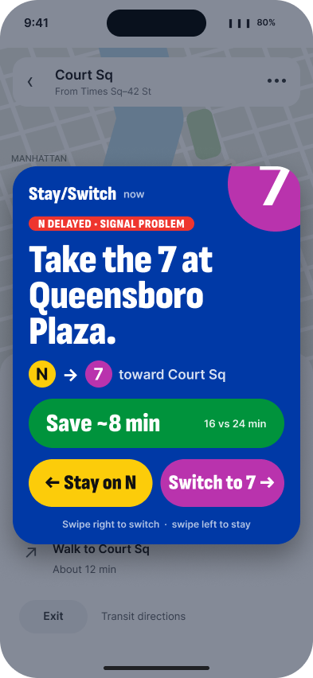
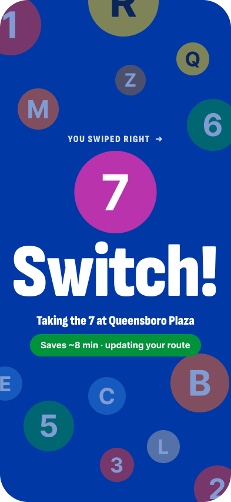
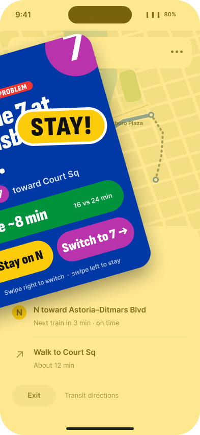
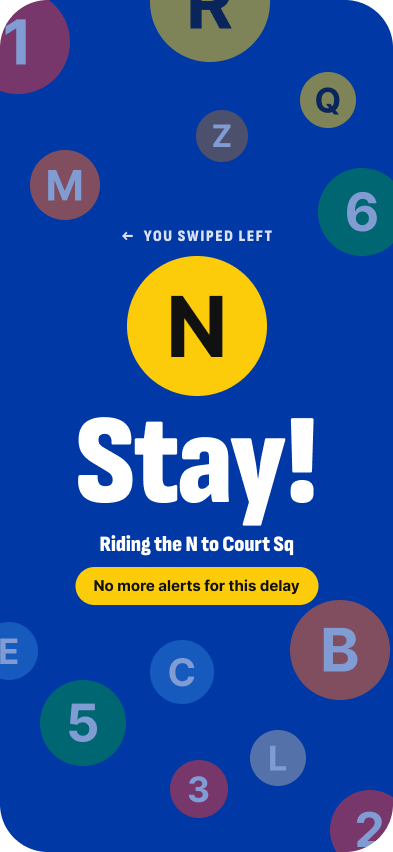

# Stay/Switch

A background **decision companion** for NYC subway commuters. It runs alongside Google Maps, so it isn't another navigation app. It watches your usual route, and when a disruption hits, it answers one question: **stay on your train, or switch?**

## How it works

1. **Monitor.** It follows your saved commute in the background using public MTA real-time feeds.
2. **Compare.** When there's a disruption, it estimates your arrival time two ways: staying on your current line, or taking the best alternative.
3. **Decide.** It notifies you only when switching *clearly* beats staying. You get one useful alert, never a stream of updates.
4. **Explain.** The alert gives the recommendation, the reason (for example, "signal problem on the N"), the time you'd save, and how confident the estimate is.
5. **You choose.** Swipe right to switch or left to stay. Either way, you won't get more alerts for that delay.

## Who it's for

Recurring NYC commuters with familiar routes and real alternatives. The starting scope is one corridor and a pilot cohort, with a goal of the first 100 users.

## Prototype

- [Flow A: alert over the live map](https://www.figma.com/proto/APPnke6Vdqi41XHgNe8eIh/Untitled?node-id=11-3&starting-point-node-id=11%3A3&scaling=scale-down)
- [Flow B: alert on the home screen](https://www.figma.com/proto/APPnke6Vdqi41XHgNe8eIh/Untitled?node-id=11-541&starting-point-node-id=11%3A541&scaling=scale-down)
- [`index.html`](index.html) embeds both flows on one page.

### Flow, step by step

| 1. Riding | 2. Alert arrives | 3. Swipe right | 4. Switch! |
|---|---|---|---|
|  |  |  |  |

| 5. Or swipe left | 6. Stay! | 7. Back to the trip |
|---|---|---|
|  |  |  |

## Status and next steps

The current historical evaluation follows the feed visible at each passenger
decision time: choose the earliest advertised usable service, then update that
choice when a later feed changes the situation. Unselected trains' missing final
records do not block a comparison. See the
[feed-following replay plan](algo/docs/november-feed-replay-plan.md) and
[new results](algo/reports/november-feed-replay-test.md). The model and existing
two-minute boarding-safe recommendations are reused exactly; this changes the
execution evaluator, not the training or route advice.
Read the [findings](algo/reports/november-feed-replay-findings.md) with the
counts. A [selected-outcome quality correction](algo/docs/november-feed-outcome-quality-addendum.md)
excludes physically impossible collapsed prediction timelines symmetrically;
it never changes which train the simulated passenger chooses.

The latest algorithm version separates boarding feasibility from historical
ETA correction. Its [boarding-safe entrypoint](algo/docs/boarding-safe-handoff.md)
requires a two-minute initial margin; positive average delay cannot make a
train catchable. The [repair study](algo/docs/november-repair-plan.md) compares
old and new recommendations using the same historical route execution, which
can continue to the next train while retaining the original boarding failure.
This is a post-hoc comparison on the existing November weekday cohort. The
full-October model and earlier frozen studies below remain preserved.
The preceding stricter executor remains in the
[repaired results](algo/reports/november-repair-test.md) and
[interpretation](algo/reports/november-repair-findings.md). Boarding feasibility
improves substantially; strict first-service route ordering still leaves many
outcomes unknown, so the study does not establish a general severe-Switch
success rate or a consistent advantage over raw MTA.

The active extension follows the [full-October / November analysis plan](algo/docs/november-five-corridor-plan.md):
a separate model fitted on October 1–31, 2026, followed by service-delay
evaluation and daily peak ETA-error analysis on the existing five corridors.
The [weekday reporting addendum](algo/docs/november-weekday-reporting.md) selects
November 2–6, 9–13, and 16–18 for the primary results. The original October 1–17 model and every prior frozen experiment
remain preserved. November 2–15 had prior project exposure; the new analysis
also reports November 16–18 separately.
The initial algorithm user has not boarded and is leaving now; the screens
above illustrate the broader product concept.

The extension is complete. The [new training report](data/reports/full-october-fit.md)
records 870,415 eligible observations from all 31 October days. Read the
[November interpretation](algo/reports/november-weekday-interpretation.md) with
the [frozen Stay/Switch results](algo/reports/november-weekday-test.md): among
197 earliest weekday corridor/notice-family representatives, the model makes
34 Switch recommendations, with 11 meaningful gains, one tie, one loss and
21 unknown outcomes. This is not an overall success rate. Selected-train
catchability remains a practical weakness, and incident-specific correction
has not demonstrated an advantage over the time-only baseline.

The [weekday peak report](data/reports/november-weekday-peak-delays.md) provides
195 daily corridor/period cells, with usable outcomes at 2,360 of 2,860 fixed
departure checkpoints. It reports both signed ETA error and positive-only
delay, retaining unknown outcomes and the exact selected-train limitation.
The original experiment and all earlier frozen results below remain unchanged.

October data preparation, time-conditioned historical profiles and multi-route
replays are complete. See the [historical delay tables](data/reports/profiles-horizon-notes.md)
and [final test report](algo/reports/october-test.md). Severe-Switch effectiveness
could not be assessed by that original benchmark: the fastest-MTA reference
had no definite severe exposure. A separate [affected-route Stay replay](algo/reports/affected-stay-context.md)
now tests the commuter's disrupted-route scenario with unchanged predictions.
Its post-hoc results and outcome coverage do not establish general success rates
or prove an advantage from historical corrections over live MTA.

The [default-route delay findings](algo/reports/default-route-delay-findings.md)
give a fully comparable missed opportunity: the originally fastest 4/5 route
remains the current MTA default, but switching to F saves 7 minutes 13 seconds
in the final-feed replay. The current algorithm recommends Stay. Negative and
unknown comparisons are retained; this is exploratory evidence, not a general
success rate or independent passenger-arrival measurement.

The [same-run delay test](algo/reports/feed-revision-test.md) separately compares alternatives
after the originally fastest route's same service run receives a later arrival
forecast. It retains both qualifying examples from the fixed test-week search,
with forecast advice and screened final MTA outcomes reported separately.

An earlier [pre-incident route comparison](algo/reports/preincident-brooklyn-clear-default.md)
fixes the default before an official notice. Its apparent duration deterioration
also involves selecting later trains. A [same-train audit](algo/reports/preincident-brooklyn-headway-audit.json)
shows that its positive counterfactual does not establish delay of the originally
selected train. It remains a valid route-level comparison, with the changed
train and later train's own forecast error distinguished in the findings.

See the [algorithm workspace](algo/README.md) and [data workspace](data/README.md)
for implementation status, reproducible commands and measured results. The
previous November model/data experiment has been removed from the active project.

The [three-corridor Google-path experiment](algo/docs/google-corridor-experiment.md)
uses current Google recommendations to fix Stay paths, then replays October
service problems with historical train records. Current Google durations are
recorded separately and never substitute for historical outcomes. Its provider
and walking inputs are documented in [the capture record](data/docs/google-corridors.md).
Read the [audited findings](algo/reports/google-corridors-findings.md): the primary
LIC F-to-G example saves 23m35s in the MTA-based replay; Grand Central's 5-to-4
gains have little boarding margin, and Court Square's large fixed-train gap
does not establish adaptive Stay-on-7 savings. Severe-stage Switch benefit
remains unverified. The report separates 49 event representatives from 322
repeated checkpoints and preserves unknown and missed-train outcomes.

The subsequent [five-corridor incremental comparison](algo/reports/five-corridor-incremental-findings.md)
tests when the raw-MTA decision rule says Stay but the historical model says
Switch. It adds a fixed five-minute checkpoint grid and two Google-defined
paths, keeping the total at five corridors. Same-platform service changes count
as normal Switch choices. Its aggregate excludes duplicate earlier cohorts and
walking variants; read the case and outcome-quality qualifications with the counts.
The user-approved [five departure-time examples](algo/reports/incremental-timepoint-examples.md)
retain repeated train pairs at different times. They come from a separately
labeled 30-second illustration study and do not inflate the overall evaluation.

The product is software only. The core experience is free, and premium features and ads haven't been tested. Hardware is set aside for future exploration.
