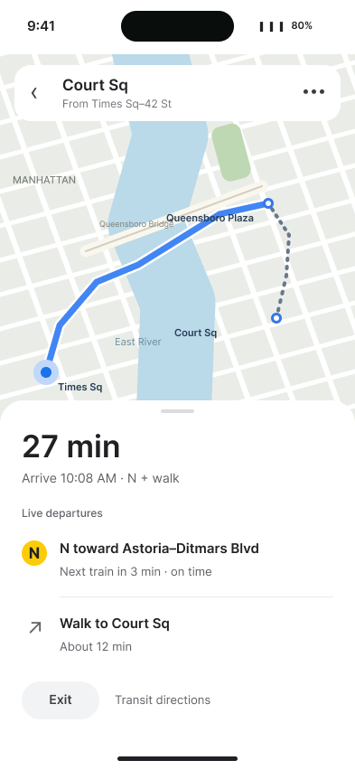
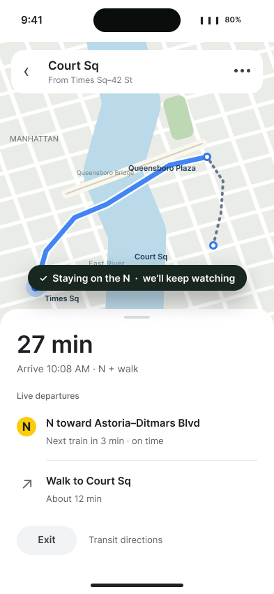

# Stay/Switch

A background **decision companion** for NYC subway commuters. It runs alongside Google Maps, so it isn't another navigation app. It watches your usual route, and when a disruption hits, it answers one question: **stay on your train, or switch?**

## How it works

1. **Monitor.** It follows your saved commute in the background using public MTA real-time feeds.
2. **Compare.** When there's a disruption, it estimates your arrival time two ways: staying on your current line, or taking the best alternative.
3. **Decide.** It notifies you only when switching *clearly* beats staying. You get one useful alert, never a stream of updates.
4. **Explain.** The alert gives the recommendation, the reason (for example, "signal problem on the N"), the time you'd save, and how confident the estimate is.
5. **You choose.** Swipe right to switch or left to stay. Either way, you won't get more alerts for that delay.

## Who it's for

Recurring NYC commuters with familiar routes and real alternatives. The starting scope is one corridor and a pilot cohort, with a goal of the first 100 users.

## Prototype

- [Flow A: alert over the live map](https://www.figma.com/proto/APPnke6Vdqi41XHgNe8eIh/Untitled?node-id=11-3&starting-point-node-id=11%3A3&scaling=scale-down)
- [Flow B: alert on the home screen](https://www.figma.com/proto/APPnke6Vdqi41XHgNe8eIh/Untitled?node-id=11-541&starting-point-node-id=11%3A541&scaling=scale-down)
- [`index.html`](index.html) embeds both flows on one page.

### Flow, step by step

| 1. Riding | 2. Alert arrives | 3. Swipe right | 4. Switch! |
|---|---|---|---|
|  |  |  |  |

| 5. Or swipe left | 6. Stay! | 7. Back to the trip |
|---|---|---|
|  |  |  |

## Status and next steps

The active algorithm work follows the [October implementation plan](algo/docs/october-implementation-plan.md):
historical ETA delay by time of day and meaningful switching during severe
service problems, using October 1–31, 2026 history and multiple route families.
The initial algorithm user has not boarded and is leaving now; the screens
above illustrate the broader product concept.

October data preparation, time-conditioned historical profiles and multi-route
replays are complete. See the [historical delay tables](data/reports/profiles-horizon-notes.md)
and [final test report](algo/reports/october-test.md). Severe-Switch effectiveness
could not be assessed by that original benchmark: the fastest-MTA reference
had no definite severe exposure. A separate [affected-route Stay replay](algo/reports/affected-stay-context.md)
now tests the commuter's disrupted-route scenario with unchanged predictions.
Its post-hoc results and outcome coverage do not establish general success rates
or prove an advantage from historical corrections over live MTA.

See the [algorithm workspace](algo/README.md) and [data workspace](data/README.md)
for implementation status, reproducible commands and measured results. The
previous November model/data experiment has been removed from the active project.

The product is software only. The core experience is free, and premium features and ads haven't been tested. Hardware is set aside for future exploration.
