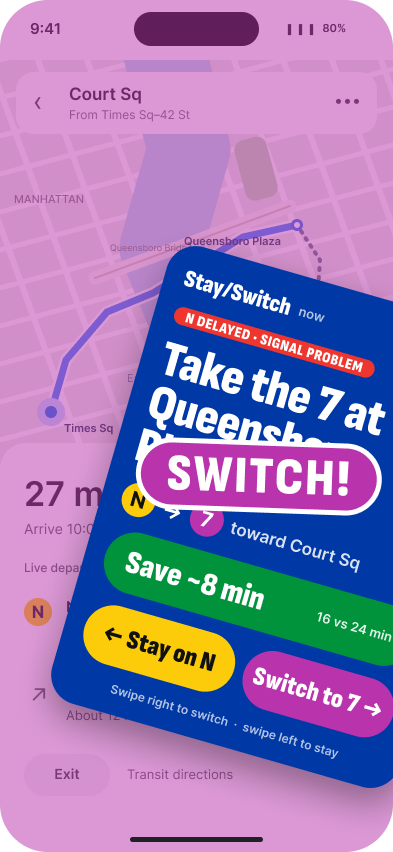

# Stay/Switch

<p align="center"></p>

A background **decision companion** for NYC subway commuters. It runs alongside Google Maps, so it isn't another navigation app. It watches your usual route, and when a disruption hits, it answers one question: **stay on your train, or switch?**

## November experiment

[Read the two-corridor results](algo/reports/november-recorded-boarding.md) or [inspect the 595 recommendations and their train traces](algo/reports/november-recorded-boarding.json).

| When the model recommended Switch | Issued | Classifiable | Faster than Stay | Mean minutes saved per classifiable Switch |
|---|---:|---:|---:|---:|
| Grand Central → Borough Hall | 152 | 38 | 23 (60.5%) | 2.16 |
| Court Square → Times Square | 31 | 11 | 3 (27.3%) | −2.87 to −2.81 |

The model used October 1–31, 2026. The replay covers 13 November weekdays and boards both options by recorded departures after platform readiness. Historical MTA journal and vehicle records provide the departure and arrival evidence. The full table includes Stay recommendations, slower journeys, ties and missing outcomes. The corridors were selected after an earlier comparison.

### Reproduce the result

Run from the repository root with Python 3.9 or later.

```sh
python3 -m venv .venv
.venv/bin/python -m pip install -r algo/requirements-live-lock.txt
.venv/bin/python algo/scripts/evaluate_recorded_boarding.py
```

The command uses bundled evidence, works offline after dependency installation, and regenerates both linked results. The [algorithm handoff](algo/README.md) describes how to make a new recommendation. The [data guide](data/README.md) identifies the model, inputs and supporting weekday ETA statistics.

## How it works

1. **Monitor.** It follows your saved commute in the background using public MTA real-time feeds.
2. **Compare.** When there's a disruption, it estimates your arrival time two ways: staying on your current line, or taking the best alternative.
3. **Decide.** It notifies you only when switching *clearly* beats staying. You get one useful alert, never a stream of updates.
4. **Explain.** The alert gives the recommendation, the reason (for example, "signal problem on the N"), the time you'd save, and how confident the estimate is.
5. **You choose.** Swipe right to switch or left to stay. Either way, you won't get more alerts for that delay.

## Who it's for

Recurring NYC commuters with familiar routes and real alternatives. The starting scope is one corridor and a pilot cohort, with a goal of the first 100 users.

## Prototype

- [Flow A: alert over the live map](https://www.figma.com/proto/APPnke6Vdqi41XHgNe8eIh/Untitled?node-id=11-3&starting-point-node-id=11%3A3&scaling=scale-down)
- [Flow B: alert on the home screen](https://www.figma.com/proto/APPnke6Vdqi41XHgNe8eIh/Untitled?node-id=11-541&starting-point-node-id=11%3A541&scaling=scale-down)
- [`index.html`](index.html) embeds both flows on one page.

### Flow, step by step

| 1. Riding | 2. Alert arrives | 3. Swipe right | 4. Switch! |
|---|---|---|---|
|  |  |  |  |

| 5. Or swipe left | 6. Stay! | 7. Back to the trip |
|---|---|---|
|  |  |  |
