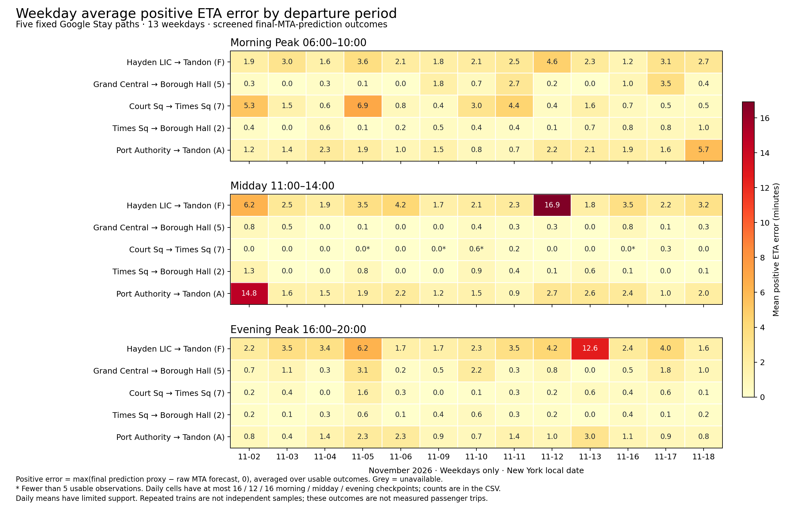

# November weekday peak ETA delays

Primary analysis dates: **November 2–6, 9–13 and 16–18, 2026**, America/New_York. Only these 13 weekdays contribute outcomes and means. November 19 is boundary evidence only. October 1–31 model training remains unchanged.

The same five Google-selected Stay paths are sampled every 15 minutes: morning 06:00–10:00, midday 11:00–14:00, evening 16:00–20:00, with end times excluded. There are **2,860 scheduled corridor checkpoints and 195 daily cells**. Midday is an analysis window, not an empirically established peak.

2860 / 2860 scheduled weekday checkpoints have a complete raw-MTA forecast; **2360 / 2860 (82.5%)** have usable paired proxy outcomes after confirmation, endpoint-age, identity and boarding checks. Missing or missed-boarding outcomes remain unknown and never become zero.

Signed ETA error is inferred final destination arrival minus the raw MTA forecast. Positive-only mean averages max(error, 0) over all usable outcomes; it is not mean delay conditional on being late. The main mean weights scheduled departure times equally. Repeated trains are retained for this departure-time estimand and are not independent samples. The secondary event-balanced mean uses the earliest frozen checkpoint per physical train sequence, date, period and forecast-duration band.

Google's November 20 choice supplies the fixed path and walking assumptions; its current travel minutes are not historical outcomes. All five Stay paths have one train leg, so fixed egress cancels from the paired error after checking boarding feasibility. These are exact selected-train, final-MTA-prediction proxies, not independently measured passenger trips or an adaptive policy taking whichever same-line train arrives first.

## Average ETA error by weekday period

All time values are minutes. Pooled means retain each corridor's observed forecast-duration mix.

| Corridor | Period | Signed mean | Positive-only mean | Event-balanced signed mean | Usable / scheduled | Distinct usable trains |
|---|---|---:|---:|---:|---:|---:|
| pilot_hayden_tandon | MORNING_PEAK | 2.34 | 2.44 | 2.34 | 180 / 208 | 180 |
| pilot_hayden_tandon | MIDDAY | 3.68 | 3.73 | 3.68 | 140 / 156 | 140 |
| pilot_hayden_tandon | EVENING_PEAK | 3.19 | 3.25 | 3.18 | 179 / 208 | 178 |
| grandcentral_boroughhall | MORNING_PEAK | -1.17 | 0.77 | -1.13 | 189 / 208 | 186 |
| grandcentral_boroughhall | MIDDAY | -1.24 | 0.28 | -1.24 | 153 / 156 | 151 |
| grandcentral_boroughhall | EVENING_PEAK | -0.59 | 0.98 | -0.58 | 197 / 208 | 191 |
| courtsquare_timessquare | MORNING_PEAK | 1.52 | 1.81 | 1.51 | 131 / 208 | 108 |
| courtsquare_timessquare | MIDDAY | -3.42 | 0.08 | -3.42 | 74 / 156 | 74 |
| courtsquare_timessquare | EVENING_PEAK | -0.04 | 0.41 | -0.04 | 124 / 208 | 124 |
| timesquare_boroughhall | MORNING_PEAK | -0.59 | 0.48 | -0.60 | 160 / 208 | 157 |
| timesquare_boroughhall | MIDDAY | -1.08 | 0.35 | -1.08 | 133 / 156 | 130 |
| timesquare_boroughhall | EVENING_PEAK | -1.13 | 0.26 | -1.13 | 167 / 208 | 166 |
| portauthority_tandon | MORNING_PEAK | 1.43 | 1.76 | 1.43 | 187 / 208 | 186 |
| portauthority_tandon | MIDDAY | 2.33 | 2.56 | 2.33 | 150 / 156 | 149 |
| portauthority_tandon | EVENING_PEAK | 0.96 | 1.33 | 0.96 | 196 / 208 | 196 |

## Fixed Stay paths

| Corridor | Stay |
|---|---|
| pilot_hayden_tandon | F: Court Sq-23 St to Jay St-MetroTech |
| grandcentral_boroughhall | 5: Grand Central-42 St to Borough Hall |
| courtsquare_timessquare | 7: Court Sq to Times Sq-42 St |
| timesquare_boroughhall | 2: Times Sq-42 St to Borough Hall |
| portauthority_tandon | A: 42 St-Port Authority Bus Terminal to Jay St-MetroTech |

## Daily results

[Daily CSV](november-weekday-peak-delays-daily.csv) contains all 195 weekday cells with means, usable/scheduled counts, distinct trains and event-balanced values. [Pooled CSV](november-weekday-peak-delays-pooled.csv) has the 15 corridor/period summaries. [Duration strata](november-weekday-peak-delays-duration-band.csv) expose the prediction-distance mix.

The heatmap shows mean positive error among usable fixed-grid journeys. Grey means unavailable, not zero. An asterisk marks fewer than five usable observations. Daily cells have at most 16 morning, 12 midday or 16 evening observations, so daily averages have limited support even when unmarked; exact counts remain in the CSV.

The required endpoints retain original quality checks and must have archived confirmation, matching train/stop identity, and absolute last-observed-to-proxy distance at most 180 seconds. Missing endpoints and missed selected trains retain distinct outcome statuses.

[Complete JSON and provenance](november-weekday-peak-delays.json) includes all summaries and quality counts. The original 3,960-row all-date input freeze is preserved; it contributes no weekend outcomes to this weekday report.

## Interpretation audits

A small positive-only error is not a measure of overall accuracy. For Court
Square's 7 at midday, 74 of 156 checkpoints are comparable: the positive-only
mean is 0.08 minutes, but the signed mean is -3.43 minutes and mean absolute
error is 3.58 minutes. The [raw-source check](november-weekday-seven-raw-audit.md)
confirms explicit arrival/departure fields and shows that the negative residual
mainly reflects an overestimated wait for the selected train, not terminal dwell.

The [large-cell audit](november-weekday-large-peak-raw-audit.md) verifies all 22
usable journeys behind the three highest daily cells. F on November 13 evening
has only 5 of 16 usable checkpoints; one 51.43-minute selected-train error raises
its mean to 12.59 minutes, while its median is 2.73 minutes. F on November 12
midday and A on November 2 midday have medians around 13 minutes across 8 and 9
usable trains respectively. These remain exact selected-train forecast errors;
they are not measurements of an adaptive passenger taking another earlier train.
The audits preserve every original value, prediction and denominator.
